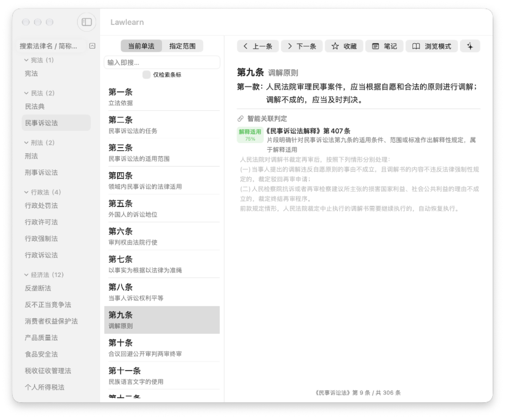
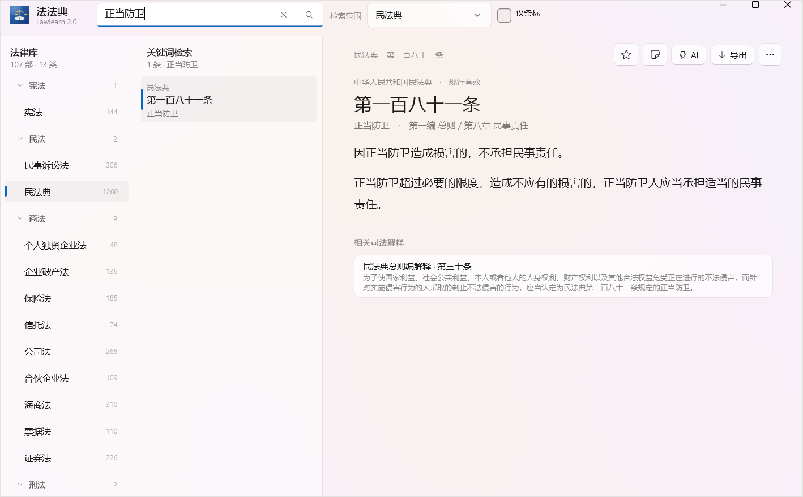
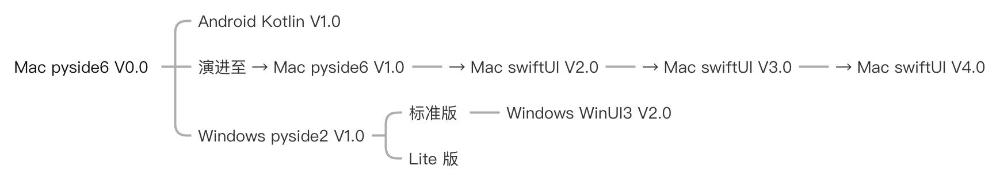

<div align="center">


# 法法典 Lawlearn

中文法律条文检索与智能解读工具

<sub>macOS 14+ &nbsp;·&nbsp; Windows 10 1809+（2.0）· Windows 7 SP1+（1.5.1 / Lite） &nbsp;·&nbsp; Android 8.0+</sub>

**本仓库仅存放安装包，不包含源代码。**

</div>



### Windows 2.0.0 实机画面

下面是 Windows 2.0.0（WinUI 3）在 Windows 11 上真实运行的截图：搜索「正当防卫」，中栏给出检索结果，右栏显示《民法典》第一百八十一条正文与关联司法解释，左栏是按大组折叠的法律库。



## 版本演进

<p align="center">
  
</p>

macOS 端从 PySide6 原型起步，依次走过 SwiftUI 2.0、3.0，当前为 SwiftUI 4.0；Windows 端从 PySide2 分支走向 WinUI 3 标准版，Lite 版继续保留轻量路线；Android 端为 Kotlin 版本。


## 下载

| 平台 | 版本 | 技术栈 | 系统要求 | 安装包 |
| :--- | :--- | :--- | :--- | :--- |
| macOS | **4.0.1** | Swift · SwiftUI | macOS 14.0 及以上 | [Lawlearn-4.0.1.dmg](https://github.com/QuotOS-Aurora-Lab/Lawlearn_Download/releases/download/macOS-v4.0.1/Lawlearn-4.0.1.dmg) · 33 MB |
| Windows | **2.0.0** | C# 12 · .NET 8 · WinUI 3 | Windows 10 1809（build 17763）及以上，64 位 | [Lawlearn-Setup-2.0.0.exe](https://github.com/QuotOS-Aurora-Lab/Lawlearn_Download/releases/download/Windows-v2.0.0/Lawlearn-Setup-2.0.0.exe) · 92 MB |
| Windows（Win7 存档） | 1.5.1 | Python · PySide2（Qt 5.15） | Windows 7 SP1 及以上（64 位） | [Lawlearn-Setup-1.5.1.exe](https://github.com/QuotOS-Aurora-Lab/Lawlearn_Download/releases/download/Windows-v1.5.1/Lawlearn-Setup-1.5.1.exe) · 206 MB |
| Windows Lite | 1.5.1 | 同上 | 同上 | [Lawlearn-Lite-Setup-1.5.1.exe](https://github.com/QuotOS-Aurora-Lab/Lawlearn_Download/releases/download/Windows-v1.5.1-Lite/Lawlearn-Lite-Setup-1.5.1.exe) · 136 MB |
| Android | 1.3.2 | Kotlin | Android 8.0 及以上 | [Lawlearn_v1.3.2_android.apk](https://github.com/QuotOS-Aurora-Lab/Lawlearn_Download/releases/download/Android-v1.3.2/Lawlearn_v1.3.2_android.apk) · 29 MB |

全部历史版本都在 [Releases](../../releases) 里，最早可以追溯到 1.2.3。旧版存档：

- macOS：[1.2.3](https://github.com/QuotOS-Aurora-Lab/Lawlearn_Download/releases/download/macOS-v1.2.3/Lawlearn_v1.2.3_macOS.dmg)（Python · PySide6） · [2.6.0](https://github.com/QuotOS-Aurora-Lab/Lawlearn_Download/releases/download/macOS-v2.6.0/Lawlearn-2.6.0.dmg)
- Windows：[1.5.1](https://github.com/QuotOS-Aurora-Lab/Lawlearn_Download/releases/tag/Windows-v1.5.1)（最后一个兼容 Windows 7 的版本） · [1.2.6](https://github.com/QuotOS-Aurora-Lab/Lawlearn_Download/releases/tag/Windows-v1.2.6) · [1.2.5](https://github.com/QuotOS-Aurora-Lab/Lawlearn_Download/releases/tag/Windows-v1.2.5)

> [!NOTE]
> **Windows 7 / 8.1 兼容性说明**
>
> 2.0.0 换用 WinUI 3 重写，**要求 Windows 10 1809（build 17763）及以上、64 位**；
> Windows 7 SP1、Windows 8.1 和 32 位系统无法运行，安装程序会直接拦下。
>
> 仍在用这些系统请下载上表的 **1.5.1 完整版**（或 1.5.1 Lite）：
> **1.5.1 是最后一个兼容 Windows 7 的版本**，功能已冻结、不再更新，仅作存档；
> 它的 Python + PySide2 界面与 2.0.0 差别较大，但四卷法条库内容一致、Win7 SP1 及以上可正常运行。
>
> 1.5.1 完整版与 2.0.0 共用 `%APPDATA%\lawlearn`，收藏、笔记、历史沿用同一套表结构，
> 日后换到 Windows 10 以上再装 2.0.0 时无需迁移；Lite 版的数据单独放在
> `%APPDATA%\lawlearn\db-lite`，与完整版互不干扰。

> [!IMPORTANT]
> macOS 的 1.x / 2.x 与 Windows 1.5.1 及更早版本属于存档，界面结构、功能范围与当前版本差别很大，未必适配新系统。日常使用请以上面表格里的当前版本为准；Windows 7 用户见上方兼容性说明。

## macOS 专属 · Aether 四位对话伙伴

> [!NOTE]
> **这是 Mac 端独有的一个小彩蛋，不是各平台共有的功能。** 只有 macOS 版（3.14.0 及以上）才有；Windows 2.0.0 / 1.5.1 与 Android 版都没有，也不影响它们一致的法条检索与学习功能。

在「设置 → 智能」里点一张卡片，按 ⌥⌘A 打开的对话小窗就会换成这位角色的形象和说话方式。没联网、没填密钥时也能聊——它会直接翻本地法条库，把相关条文列给你。

| <br>**Cecil** | <br>**Aetheria** | <br>**Nox** | <br>**夏依恩** |
| :---: | :---: | :---: | :---: |
| 冷静可靠的赛博管家，理性、克制、护短，习惯称你一声「阁下」。 | 傲娇却靠谱的女仆，嘴上不饶人，关键时刻把你护得好好的。 | 住在电脑里的粉紫色小幽灵，软软糯糯、慢半拍，却一句话点到关键。 | 獬豸化形的大小姐，傲娇毒舌、讲究格式，遇上不公第一个替你出头。 |

四位各有自己的说话习惯和小心思；夏依恩还有点自己的小忌讳——碰上了会被请出当前这段对话，新建一段就好。

## 体验激活码

以下激活码适用于 **macOS 版**，供体验 Ultimate（本地大模型）的完整功能。原 Pro 档位已取消，智能解释、Casus® 分析、推理强度、Aether 角色与全部图标现在**下载即用、永久免费**，不再需要 Pro 激活码。**不保证对将来的新版本永久有效**，如某天失效，以届时页面上的说明为准。

| 版本 | 激活码 |
| :--- | :--- |
| Ultimate | `ULT6Q-Y7UM7-5FTSK-5QJSZ-GRFWT` |

- Ultimate 码在「Lawlearn AI Ultimate」入口输入；标准版功能无需任何激活码。
- 激活成功后绑定当前设备；把配置拷贝到另一台机器会失效，需要重新激活。
- **Windows 版没有版本分层**，安装后即可使用全部功能，不需要激活码。
- **Android 版**的 AI 升级是演示流程，请使用应用内提示的演示码，上面两个码在安卓上无效。

## 选哪个版本

**Windows 现在主推 2.0.0 完整版，Lite 仍停在 1.5.1**，按需要选一个装即可，不要同时装：

- **2.0.0 完整版（推荐）**：C# / .NET 8 / WinUI 3 重写，自包含，目标机不需要预装 .NET、Python 或 Windows App Runtime；要求 Windows 10 1809 及以上、64 位。包含全部法律条文与司法解释，法条库按四卷组织——核心法（宪法、民法、商法、刑法）、附加法（行政、经济、知识产权、劳动社保、环境资源）、司法解释、国际法，合计 **107 部 / 9408 条**。
- **Lite 版（1.5.1，未变）**：只包含民商法相关的法条，体积更小、启动更快，适合日常查民商事条文，也兼容 Windows 7 SP1。收录民法 / 商法 / 知识产权 **14 部 / 3266 条**，以及对应的司法解释 **35 部 / 1564 条**。

2.0.0 与 1.5.1 完整版的数据都放在 `%APPDATA%/lawlearn/db`，收藏、笔记、历史沿用同一套表结构，升级不用迁移；Lite 版独立放在 `%APPDATA%/lawlearn/db-lite`，即使先后都装过也不会互相串数据。

**本地 AI 模型（1.5.1 起，2.0.0 同样支持）**：完整版安装包只带推理运行时，不含模型权重，在 AI 设置里按需下载（迷你 0.5B / 轻量 1.5B / 标准 3B / 增强 7B，0.5–4.4 GB，存本机用户目录）；不下载也能用云端 API。Lite 版不含推理运行时，只能使用云端 API。

## 安装说明

### macOS

1. 下载 `.dmg` 后双击打开，把 `Lawlearn` 拖进「应用程序」文件夹。
2. 首次打开如果提示「无法验证开发者」，到「系统设置 → 隐私与安全性」里点「仍要打开」。
3. 如果提示文件已损坏，在终端执行一次下面这行再打开：

```bash
xattr -dr com.apple.quarantine /Applications/Lawlearn.app
```

### Windows

1. 运行 `.exe` 安装包，按中文向导完成安装。**2.0.0 要求 Windows 10 1809 及以上、64 位**；Windows 7 用户请改用 1.5.1（见上方兼容性说明）。
2. 程序默认装在当前用户目录下（2.0.0 为 `%LOCALAPPDATA%\Programs\Lawlearn`），不需要管理员权限。
3. SmartScreen 拦截时点「更多信息 → 仍要运行」。
4. 2.0.0 重复安装会识别为升级；卸载走「设置 → 应用」或开始菜单卸载项，**不会删除** `%APPDATA%\lawlearn` 里的收藏、笔记、模型与设置。

### Android

1. 下载 `.apk` 后点击安装，需要在系统设置里允许「安装未知来源应用」。
2. 覆盖升级时请使用同一个签名版本，否则需要先卸载旧版——卸载会清空本地的收藏、笔记与浏览记录。

## 使用说明（macOS 版）

以下说明以 macOS 版为准，Windows 版和 Android 版功能基本一致，界面略有不同。说明里的 ⌘ 是 Command 键，⇧ 是 Shift，⌥ 是 Option。

### 收录了什么

139 部法律和司法解释、共 10,153 条条文（其中司法解释 92 份、3,469 条），全部存在你的电脑里。**断网也能查条文**，不联网不登录就能完成日常检索和阅读。

### 界面怎么用

打开软件，你会看到三块区域：

- **左边**：所有法律的列表，按类别分组（宪法、民法、刑法……）。顶部搜索框可以直接输入法律名字，也认拼音，比如 `mfd` 找到《民法典》、`xzxkf` 找到《行政许可法》。
- **中间**：点一部法律，这里列出它的全部条文；搜索时这里显示搜索结果。
- **右边**：条文正文。有的条文下面会自动列出相关的司法解释，并标注是「补充细化」「解释适用」还是「例外排除」。

### 怎么找条文

搜索框什么都能输，软件会自己判断你想干什么：

| 你输入的 | 会发生什么 |
| :--- | :--- |
| `586` 或 `第五百八十六条` | 直接跳到第 586 条 |
| `定金`、`正当防卫` | 在所有条文里搜这个词 |
| `帮信罪`、`醉驾` | 认识这些口语说法，自动换成正式术语再搜 |
| `mfd`、`xzxkf` | 按拼音首字母找到对应法律 |
| `xingzhengxuke` | 按全拼找到《行政许可法》 |

两个小提示：输入后稍停一下才出结果，这是正常的，软件在等你打完字；默认只搜最常用的几部法，想扩大范围到「设置 → 检索范围」里勾选。

### 常用快捷键

| 按键 | 做什么 |
| :--- | :--- |
| ⌘S | 收藏当前条文 |
| ⌘N | 给当前条文写笔记 |
| ⌘R | 随机看一条 |
| ⌘E | 把当前结果导出成文件 |
| ⌘, | 打开设置 |
| ↑ ↓ 或 ⌘← ⌘→ | 上一条 / 下一条 |
| ⇧⌘S | 打开收藏夹 |
| ⇧⌘N | 打开笔记本 |
| ⇧⌘L | 查看最近浏览 |
| ⇧⌘X | 智能解释（选中文字或整条） |
| ⇧⌘K | 案情分析 |
| ⌥⌘A | 打开对话小窗 |
| Esc / 回车 | 关闭解释窗口 |

### 智能解释（免费）

在条文里选中一段文字（什么都不选就是解释整条），按 ⇧⌘X，会弹出一个小窗口，用白话给你解释这段话什么意思——用法跟查词典一样。

- 回答的详细程度分五档，在设置里调，从「只解释字面」到「讲清楚构成要件和边界情况」。
- 回答边生成边显示，随时可以点「停止」；关掉小窗也会立刻中断。
- 完成后可以直接「复制」「导出」成文本，或者接着「追问」。
- 同一条条文、同一个模型、同一档位，24 小时内再问会直接复用上次结果，不重复消耗。
- 这个功能要联网并填入自己的 AI 服务密钥（支持七家服务商，填进去会自动识别）；没有密钥时，本机装了本地模型也能用。

### 案情分析（免费）

按 ⇧⌘K，把案情描述或题目粘贴进去，软件会自动判断你贴的是哪一类：

- **选择题**：按「答案 / 解析 / 考点 / 易错点」作答，法考风格。
- **带倾向的提问**（比如「这样是不是就算正当防卫了？」）：按「结论 / 依据 / 理由 / 前提与风险」作答，会保留反例。
- **案情陈述**：按办案的完整思路分析——事实梳理、争议焦点、责任评估、赔偿核算、下一步建议。

分析保持中立：结论会带条件和适用范围，不会说「一定能赢」。

### 对话小窗

按 ⌥⌘A 打开一个独立的小聊天窗，两种用法：

- **内置对话**：软件自带一个对话页面，有几个角色可选。**没联网、没填密钥时也能用**——它会直接翻本地法条库，把相关条文列给你。
- **网页版 AI**：也可以让这个小窗打开 DeepSeek、ChatGPT 等网页（选一个即可），登录状态会保留，下次打开不用重新登录。

### 收藏、笔记、最近浏览

- **收藏**（⌘S）：可以分组管理，最多 5 个组。
- **笔记**（⌘N）：记在某条条文上，可以打标签。双击笔记进入阅读模式，点「编辑」才能改。
- **最近浏览**（⇧⌘L）：自动记录你看过的条文，点一下就能跳回去。

### 设置里能调什么

按 ⌘, 打开设置：三栏字号各自独立调，外观跟系统深浅色、左栏分组顺序可拖动、检索范围勾选、口语简称映射可自己增删、AI 密钥与本地模型配置、阅读行距与段距（带预览）。

### 你的数据在哪

- 收藏、笔记、浏览记录都只保存在你这台电脑上，**不上传到任何服务器**。
- 卸载软件（把应用丢进废纸篓）不会丢收藏和笔记，它们在系统的「资源库 → Application Support → Lawlearn」文件夹里。
- 想彻底清空重来：删掉上面那个文件夹就行，下次打开软件会自动重建。**删之前先导出备份**，删了就找不回来了。

### 几个已知的小限制

- 搜索主要按字匹配，「合理价格」搜不到「价格合理」这种换了语序的词。遇到搜不到的情况，换个词试试，或者在设置里自己加一条口语映射。
- 法条更新需要下载新版本安装包，软件不会自动更新条文。
- 条文内容以官方公布为准，软件内的检索和解读仅供学习参考，不构成法律意见。

<details>
<summary><strong>Windows 4.0.0 Beta（旧测试版，点开展开）</strong></summary>

> 这是预览版，功能与界面仍在调整，可能不稳定。**不建议把它当作唯一安装的版本**，稳妥起见请先装上表的 2.0.0 作为日常使用，再把 Beta 装到另一个目录试用。

Windows 端 4.0.0 正在更换技术栈（PySide6 + Python 3.13），目前提供三个测试包：

| 类型 | 说明 | 安装包 |
| :--- | :--- | :--- |
| Beta1 安装版 | 较早的测试构建 | [Lawlearn-Setup-4.0.0-Beta1.exe](https://github.com/QuotOS-Aurora-Lab/Lawlearn_Download/releases/download/Windows-v4.0.0-Beta1/Lawlearn-Setup-4.0.0-Beta1.exe) · 42 MB |
| Beta2 安装版 | 稍晚的测试构建 | [Lawlearn-Setup-4.0.0-Beta2.exe](https://github.com/QuotOS-Aurora-Lab/Lawlearn_Download/releases/download/Windows-v4.0.0-Beta2/Lawlearn-Setup-4.0.0-Beta2.exe) · 98 MB |
| 免安装版 | 解压后直接运行，不写系统、不产生卸载项 | [Lawlearn-Portable-4.0.0-Beta.zip](https://github.com/QuotOS-Aurora-Lab/Lawlearn_Download/releases/download/Windows-v4.0.0-Beta-Portable/Lawlearn-Portable-4.0.0-Beta.zip) · 53 MB |

- 免安装版解压后运行 `Lawlearn/Lawlearn.exe`，可以把整个文件夹放在 U 盘里带走。
- Beta 版与 2.0.0（或 1.5.1）可以同时安装，但请装在不同的目录下，避免数据文件互相覆盖。
- **4.0.0 Beta 不提供源代码。** 本节之外的下载项均为正式版本。
- 反馈问题时请注明用的是 `Beta1` 还是 `Beta2`，两者并非同一份构建。

</details>

## 校验值

下载后可以对比 SHA-256，确认文件没有损坏或被动过。macOS 上执行 `shasum -a 256 文件名`，Windows 上执行 `certutil -hashfile 文件名 SHA256`。

<details>
<summary>展开查看全部 SHA-256</summary>

| 文件 | SHA-256 |
| :--- | :--- |
| `Lawlearn-4.0.1.dmg` | `0febe56546638497720fb06d440eb626acfab98bbb326f3ec1dfd5e8fd0acebd` |
| `Lawlearn-3.14.0.dmg` | `74d9311f1d8895d0a62ab12cfcebf2668631cad6d87f234cb2fc1e0f3c651238` |
| `Lawlearn-3.13.1.dmg` | `de33a0562d7acce9100706a9feb45aacaa928fa37326b7e643c078eab145fe99` |
| `Lawlearn-3.13.0.dmg` | `f69800952895258c6e6c5863829405bf8ced8dc3d68f7b8987e7f613094cd43c` |
| `Lawlearn-3.12.1.dmg` | `eaa9ffdaa013fda069f8c602ac0f9ea92ac390bfca79d3cbd48a0d4d2901ac73` |
| `Lawlearn-3.12.0.dmg` | `c6401a7defdeef4fc5ea6b4218648a66a7f9345978c47e24619747f80ce4ae90` |
| `Lawlearn-3.11.0.dmg` | `87cbd8f0fa1eb609b8b68b153c5705647f6dc781893a4c49872d40deced201f5` |
| `Lawlearn-3.10.1.dmg` | `d82e5d2ee1824244743ca4e3d4c80cc54a2b1cef7a48d6116e64563440e2fb2d` |
| `Lawlearn-3.10.0.dmg` | `0e49ff57b36f0e3a264546a54f6c5127d360cecd68f7304b4bc1e4157b4cdd21` |
| `Lawlearn-3.9.0.dmg` | `1d7e6db3dcc52dc788910ccf130a71de8c319b93809f51c43d935b9136711066` |
| `Lawlearn-Setup-2.0.0.exe` | `b1ad8264758299b4d6c29f6b747ae4aa12bdd2772e178868134f9e63db7131b9` |
| `Lawlearn-Setup-1.5.1.exe` | `58ef347b9b3805285bbe222b248dff7c6db5ae36b893805a9de88e0bda9507ac` |
| `Lawlearn-Lite-Setup-1.5.1.exe` | `bc4f5d90029a293fedb745b50dd2ee6f2900d256b93e266bce2f03fc34f6823d` |
| `Lawlearn-Setup-1.2.6.exe` | `45fe683fd088ac9edd3ba1ed9f8b86d4fc0b8a1ff463265b73f3775124061dbc` |
| `Lawlearn-Lite-Setup-1.2.6.exe` | `b04001b6ff022024df35ad9843e22d438e37cce7c37543f864340859f1c35a3c` |
| `Lawlearn_v1.3.2_android.apk` | `e2a7993c2ac6c0cf43f8f6f6fd4fc9de9b1b4685228339453243ef7397cc11d0` |
| `Lawlearn-Setup-4.0.0-Beta1.exe` | `97b4690b4c86d50550d7a83d79e024a75bb3bfb912a590d1291a23586047d299` |
| `Lawlearn-Setup-4.0.0-Beta2.exe` | `d62188e7f3ac111917cf2c69b61076bf33b921d3013cc374b76ee401623573e0` |
| `Lawlearn-Portable-4.0.0-Beta.zip` | `9f574fd4701f7050bf53ba257314eb84f0ede5566bdeb0ddccf6ee39dec9cce5` |

</details>

## 版本说明

每个版本的改动记录写在对应 Release 的说明里，点进 [Releases](../../releases) 即可查看。

macOS **4.0.1** 是当前版本：原文与司法解释改为双向成块互见，司法解释正文下可直接回看对应原条文；法条关联链升级为可缩放的关系图；历史版本对照界面重做；历史条文改用 SQLite 按需读取，安装包与启动占用更小。Pro 档位已取消，全部功能下载即用。

Windows 2.0.0 的完整改动与 Windows 7 兼容性说明见 [Windows-v2.0.0](../../releases/tag/Windows-v2.0.0)；1.5.1 与 Lite 保持原样。

## 关于源代码

本项目的源代码未公开，本仓库也不含任何源文件。

安装包内仅包含编译后的程序与法条数据，可以自由使用本软件，但不允许反编译、二次打包或剥离版权声明后分发。法条文本本身来自公开的法律法规，司法解释文本来自公开渠道。

## 问题反馈

在 [Issues](../../issues) 里提交，请说明：

- 使用的平台与版本号（在「关于」里可以看到）
- 具体的操作步骤
- 期望的结果与实际的结果
- 如有截图或错误提示，一并附上

## 数据说明

法条数据来自公开渠道整理，检索与解读结果仅供学习参考，不构成法律意见。涉及真实案件的，请咨询执业律师。
